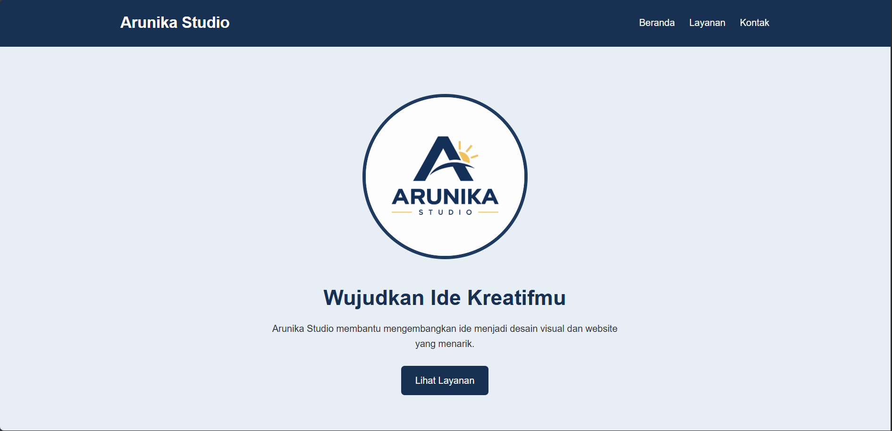
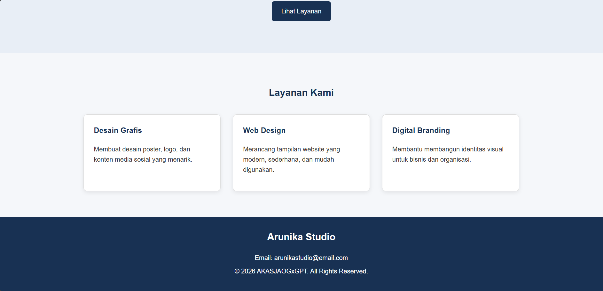

# Arunika Studio

Landing page sederhana untuk Arunika Studio, sebuah studio kreatif yang bergerak di bidang desain grafis, web design, dan digital branding.

## Fitur Website

* Header dengan navigasi Beranda, Layanan, dan Kontak.
* Hero section sebagai pengenalan studio.
* Tiga card layanan kreatif.
* Footer berisi informasi kontak.
* Desain responsif untuk desktop dan perangkat mobile.

## Teknologi yang Digunakan

* HTML5 untuk struktur halaman.
* CSS3 untuk desain dan tata letak.
* Flexbox untuk mengatur posisi elemen.
* Media Query untuk menyesuaikan tampilan pada layar kecil.

## Struktur Folder

```text
arunika-studio/
├── index.html
├── style.css
└── README.md
```

## Cara Menjalankan

1. Clone atau unduh repository proyek.
2. Buka folder `arunika-studio`.
3. Buka file `index.html` menggunakan browser.
4. Uji tampilan desktop dan mobile melalui browser.

## Konsep Desain

Website menggunakan gaya modern minimalis dengan kombinasi warna:

* Navy Blue: `#183153`
* Sunrise Gold: `#F4C95D`
* White: `#FFFFFF`

Desain dibuat sederhana agar informasi mudah dibaca dan identitas studio terlihat profesional.

## Responsive Design

Media query diterapkan pada layar di bawah 768px untuk menyesuaikan navigasi, ukuran teks, dan susunan card layanan menjadi satu kolom.

## Tujuan Proyek

Proyek ini dibuat untuk mempraktikkan penggunaan HTML dan CSS eksternal, box model, class reusable, Flexbox, serta responsive design.

## Screenshot





---

© 2026 AKASJAOG/AI/ASOY/Arunika Studio
